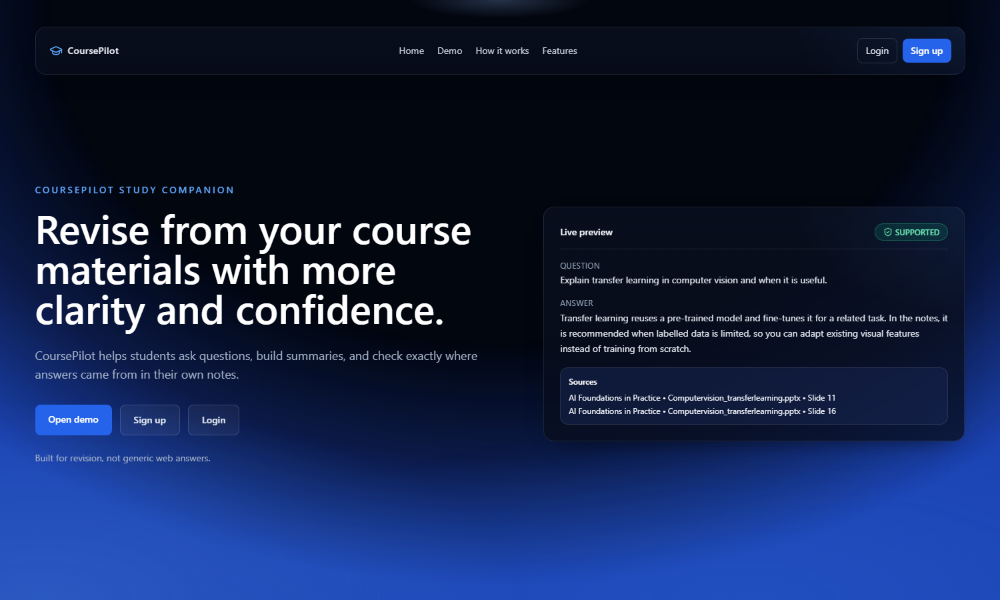
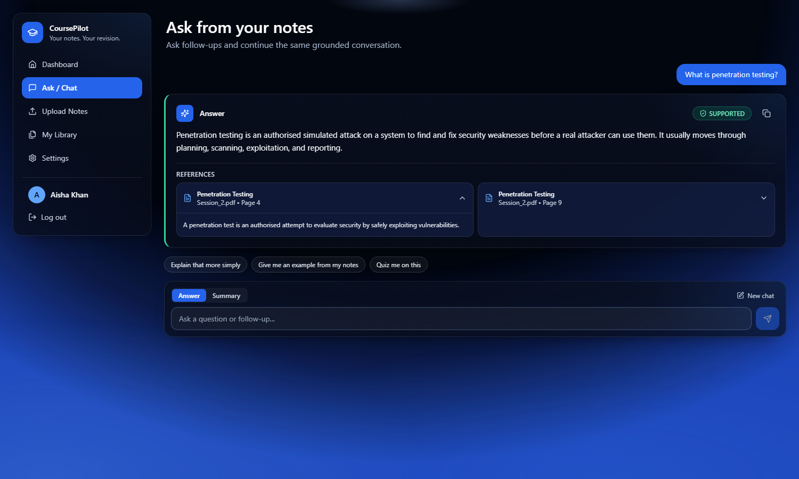
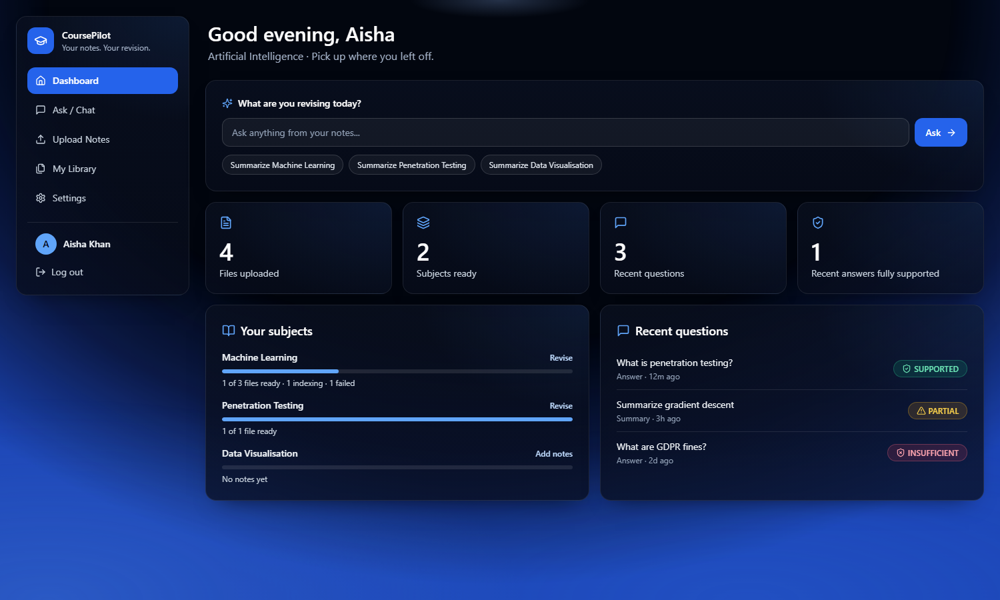
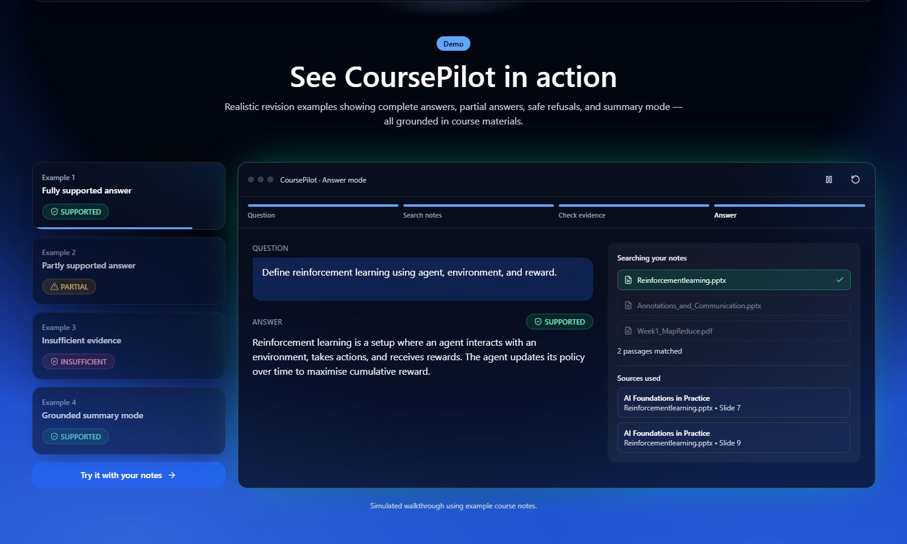
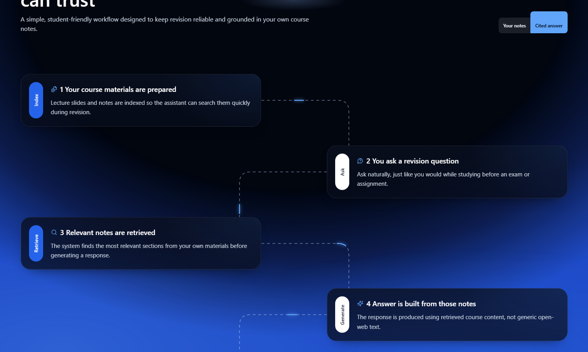
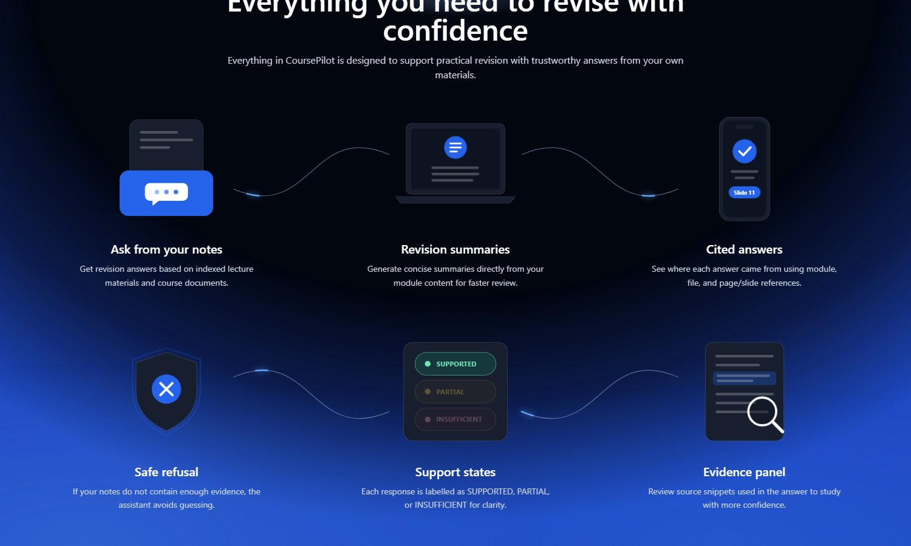
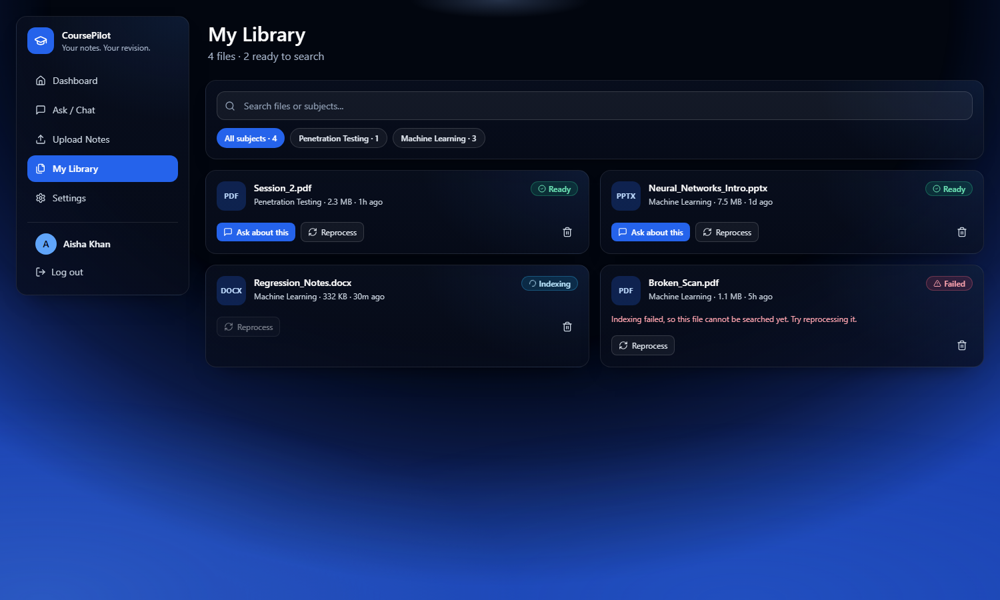
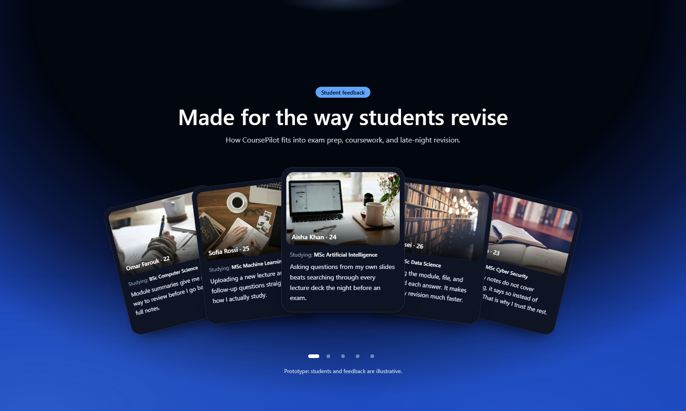
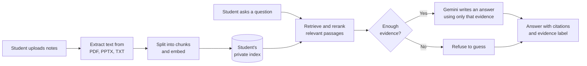

# CoursePilot

**A revision assistant that answers only from a student's own course notes, shows where every answer came from, and says so when the notes don't cover a question.**

General AI chatbots can sound confident while being wrong, and students can't easily check them. CoursePilot takes the opposite approach: answers are built from the student's uploaded slides and documents, each one cites its source, and each one carries a clear evidence label.

**[Try the live prototype](https://coursepilot.179.236.248.110.sslip.io)**

> **Status: working prototype.** The core flow runs end to end: sign up, upload notes, ask questions, and get cited answers. See [Current limitations](#current-limitations) for what a production release would still need.



## What it does

| Capability | What the student gets |
|---|---|
| **Ask from your notes** | Answers grounded in their uploaded lecture slides and documents |
| **Revision summaries** | Concise summaries generated from their own module content |
| **Cited answers** | The module, file, and page or slide behind each answer, with the source passage one click away |
| **Evidence labels** | Every response is marked `SUPPORTED`, `PARTIAL`, or `INSUFFICIENT` |
| **Safe refusal** | When the notes don't contain enough evidence, it says so instead of guessing |
| **Personal library** | Search, filter, and manage files by subject, with live indexing status |

## See it in action

### The answer workspace

Each answer shows its evidence label, and each reference expands to the passage it came from.



### The student dashboard

Students can see which subjects are ready for revision and return to recent questions.



### Guided demo

Four worked examples play as a live walkthrough, including a refusal when the evidence is missing.



<details>
<summary><strong>More screens</strong></summary>

**How it works**



**Features**



**Library**



**Student feedback section**



</details>

*Workspace screenshots use sample data. Students and feedback shown in the prototype are illustrative.*

## How it works



Each student's notes and index are kept separate, and retrieval is limited to that student's own files. For more detail, see [docs/ARCHITECTURE.md](docs/ARCHITECTURE.md).

## Evaluation

The retrieval and evidence pipeline was evaluated on a 36-question benchmark built from MSc course materials, with questions across several modules and question types.

| Measure | Result | What it means |
|---|---:|---|
| Unsupported over-answering | **0%** | It never gave a confident answer to a question the materials could not support |
| Refusal accuracy | **75%** | How often it correctly declined a question it should decline |
| Citation correctness | **77.8%** | How often a citation properly supported the claim |

The system was tuned to favour reliability, so it will sometimes refuse a question it could have answered. These results come from the benchmark baseline. **The current live Gemini model has not yet been re-benchmarked**, so treat them as evidence for the approach, not as a measure of today's live answers.

## Tech stack

| Layer | Technology |
|---|---|
| Web app | Next.js 14, React 18, TypeScript, Tailwind CSS |
| Retrieval | Python, sentence-transformers (`BAAI/bge-small-en-v1.5`), cross-encoder reranking |
| Document parsing | PyMuPDF, pypdf, python-pptx |
| Answer generation | Google Gemini |
| Prototype storage | Local files on the server |

## Run it locally

**You'll need:** Node.js 20 or later, Python 3.10 or later, and a [Google Gemini API key](https://aistudio.google.com/apikey).

**1. Install the Node dependencies**

```bash
cd frontend
npm install
```

**2. Install the Python dependencies** (from the project root)

```bash
python -m venv .venv
.venv/Scripts/pip install -r pipeline/requirements.txt   # Windows
.venv/bin/pip install -r pipeline/requirements.txt       # macOS or Linux
```

**3. Configure the app**

Copy `frontend/.env.example` to `frontend/.env.local`, then fill in:

| Setting | Value |
|---|---|
| `AUTH_SECRET` | A long random string that signs login sessions. Generate one with `openssl rand -base64 32` |
| `GEMINI_API_KEY` | Your Gemini API key |
| `RAG_PYTHON_BIN` | The path to Python in your virtual environment, such as `.venv/bin/python` |

**4. Start the app**

```bash
cd frontend
npm run dev
```

Open <http://localhost:3000>, create an account, add your subjects in **Settings**, then upload your notes.

On Windows, `install_all.cmd` and `run_frontend.cmd` do the install and start steps for you.

The first upload or question downloads the search models, so it takes longer than usual.

## Project structure

```text
frontend/
  src/app/          Pages and API routes
  src/components/   Interface components
  src/lib/          Sign-in, storage, and retrieval bridge
  scripts/          Python retrieval service called by the web app
pipeline/
  src/              Corpus processing and evaluation tools
docs/               Architecture notes and screenshots
```

## Current limitations

This is a prototype, and these are known gaps:

- **Speed:** answers took about 20 seconds in testing on the hosted server, partly because the search models reload for each question.
- **Storage:** data is kept in local JSON files, so a production release needs a proper database.
- **Concurrency:** it is designed for small demos and single-server use, not many simultaneous students.
- **Illustrative content:** students and feedback on the home page are placeholders, not real testimonials.
- **Unfinished settings:** default answer mode and notification preferences are saved but don't change behaviour yet.
- **Automated tests:** the repository doesn't include an automated test suite yet. Continuous integration currently checks types and the production build.

## Roadmap

1. Keep the search models loaded to cut response times.
2. Move accounts and records to a production database.
3. Add an automated test suite and re-run the benchmark on the live model.
4. Pilot with real students and replace illustrative feedback with real quotes, with their permission.
