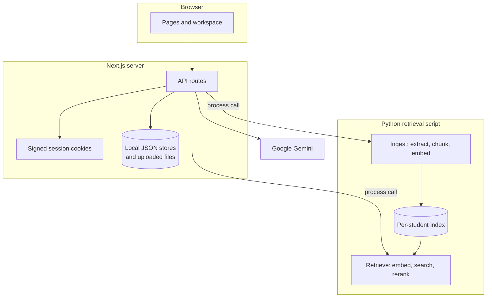

# Architecture

CoursePilot is one Next.js application that calls a Python script for document processing and search. The design goal is trustworthiness: an answer should be traceable to the student's own material, and the system should refuse rather than guess.

## System overview

## Upload flow

1. The student picks a subject and adds a file in `/upload-notes`.
2. `POST /api/files` checks the session, file type, and subject, then saves the file.
3. The server calls `frontend/scripts/rag_user_pipeline.py` in ingest mode.
4. The script extracts text, splits it into chunks, and adds embeddings to that student's index.
5. The file's status moves from uploaded to processing to indexed, or to failed.

## Question flow

1. `POST /api/rag/ask` receives the question, the mode (`answer` or `summary`), and recent conversation turns.
2. The Python script finds candidate passages for that student and reranks them.
3. Results are filtered again so that only passages from that student's own files remain.
4. Gemini receives only those passages, with instructions to use nothing else and to report its evidence level.
5. The server builds citations from the passages the model used, stores the question, and returns the answer.

## Trust safeguards

| Safeguard | How it works |
|---|---|
| Grounded prompting | The model is told to use only the supplied evidence and never to invent facts or citations |
| Evidence labels | Each response is classified as `SUPPORTED`, `PARTIAL`, or `INSUFFICIENT` |
| Safe refusal | Insufficient evidence returns a refusal and no citations |
| Citation checks | Citations are matched against retrieved passages, with fallbacks when a tagged passage is weak |
| Student data scoping | Retrieval results are filtered against the signed-in student's own file list |

## Security

- Passwords are hashed with scrypt and a per-user salt.
- Sessions use HMAC-signed cookies with a seven-day expiry.
- API routes check the session on the server. The middleware's cookie check only controls page redirects.
- Secrets are supplied through environment variables and are never committed.

## Known constraints

- The Python script starts afresh for each call, which reloads the models and adds several seconds to every question.
- Uploads wait for indexing to finish before the request returns.
- JSON stores have no locking, so simultaneous writes can overwrite each other. A database is needed before wider use.
